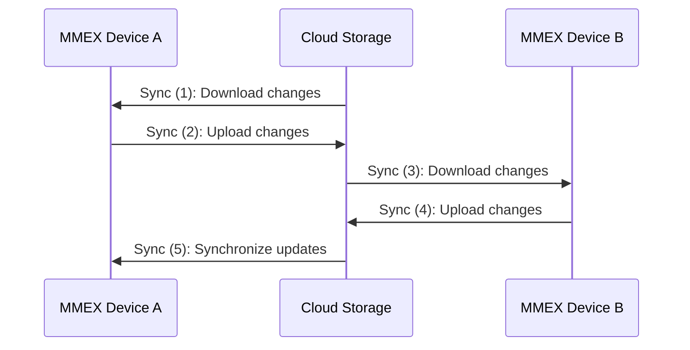
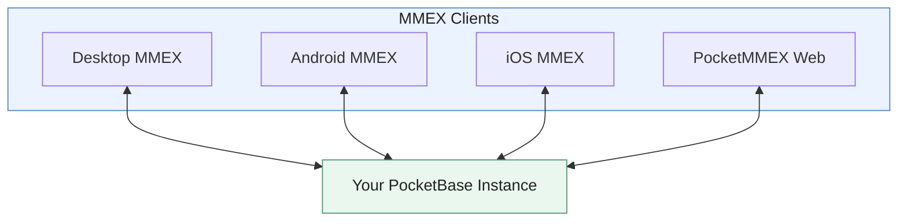

MMEX gives you the freedom to choose where your financial data lives and how it is synchronized across devices.

Instead of locking you into a specific cloud provider, MMEX supports different storage and synchronization approaches:

- **Cloud Drive Synchronization** — Store your MMEX database (`.mmb`) in a cloud storage location and let your preferred synchronization tool handle file synchronization.
- **PocketBase Synchronization** — Use your own PocketBase instance as a backend to synchronize supported MMEX data across devices.

Both approaches let you retain control over your financial data and infrastructure.

## 1. Cloud Drive Synchronization

With traditional file-based synchronization, MMEX stores your financial data in a SQLite database file (`.mmb`).

You can choose any storage and synchronization provider that works across your devices.

### Supported Storage Solutions

**Public Cloud Providers**

- Google Drive
- Microsoft OneDrive
- Dropbox
- Other cloud storage providers

**Private Cloud Providers**

- Nextcloud
- Synology NAS
- Other self-hosted storage solutions

**Phone Storage + Synchronization Tools**

- Syncthing
- Other file synchronization tools

### Desktop MMEX

- MMEX uses POSIX file system interfaces for direct database access.
- Install your preferred cloud storage client and configure its synchronization.
- Open your MMEX database directly from the synchronized folder.
- Your cloud provider handles synchronization between devices.

### Android MMEX

- MMEX integrates with Android's Storage Access Framework (SAF).
- Install your preferred cloud storage application.
- Open or create your database in a location accessible through the Android file picker.
- Enable synchronization via `Main Menu -> Settings -> Synchronization`.
  - Set the synchronization interval to 5 minutes.
  - Enable **Sync on start**.

### iOS MMEX

- MMEX integrates with Apple's File Provider Extension (FPE).
- Install your preferred cloud storage application and enable its Files integration.
- Open or create your database in a location accessible through the Files app.
- Your cloud provider handles file synchronization.

### Cloud Drive Synchronization Workflow

The following diagram illustrates how multiple MMEX devices share a database through a cloud storage provider.

The actual synchronization behavior and timing depend on the cloud storage provider and its synchronization client.

**Important:** Cloud file synchronization is not a database-level multi-user synchronization mechanism. Avoid modifying the same SQLite database simultaneously on multiple devices, as this may cause conflicts or data corruption.

## 2. PocketBase Synchronization

MMEX also supports a backend-based synchronization approach using **PocketBase**.

Instead of synchronizing an entire SQLite database file, MMEX synchronizes supported data entities through a PocketBase backend.

This approach is designed for users who prefer a self-hosted backend and want to synchronize financial data across devices without relying on cloud drive file synchronization.

### Native MMEX Integration

PocketBase synchronization is integrated directly into native MMEX applications.

Key characteristics include:

- **Native Integration:** Synchronization is implemented within MMEX applications, without requiring a separate synchronization sidecar.
- **Self-hosted Backend:** Run your own PocketBase instance and retain control over your financial data.
- **Entity-level Synchronization:** Synchronize supported MMEX data entities rather than sharing an entire SQLite database file.
- **Cross-device Access:** Connect supported MMEX clients to the same PocketBase backend.
- **Data Ownership:** Choose your own hosting environment and manage your backend infrastructure.

For implementation details, see [MMEX Pull Request #8621](https://github.com/moneymanagerex/moneymanagerex/pull/8621).

### PocketMMEX Web Client

[PocketMMEX](https://github.com/moneymanagerex/web-money-manager-ex/) extends the MMEX ecosystem with a web-based client powered by PocketBase.

It provides browser-based access to MMEX financial data through the PocketBase backend.

Together, native MMEX applications and PocketMMEX can use the same PocketBase infrastructure, providing a foundation for a connected multi-device experience.

### PocketBase Synchronization Architecture

The following diagram illustrates the PocketBase-based architecture.

*Platform availability and supported data entities depend on the current MMEX implementation. The diagram illustrates the overall architecture, not a claim that every client currently supports PocketBase synchronization.*

## 3. Cloud Drive vs. PocketBase

Both approaches provide control over your financial data, but they use different synchronization mechanisms.

| Feature | Cloud Drive | PocketBase |
| --- | --- | --- |
| Storage model | SQLite `.mmb` file | Structured data records |
| Synchronization | File synchronization | Entity-level synchronization |
| Backend | Cloud storage provider | PocketBase instance |
| Hosting | Public or private cloud storage | Self-hosted or hosted |
| Native MMEX integration | Yes | Yes, where implemented |
| Web access | Not provided by file sync itself | PocketMMEX |
| Multi-device access | Shared database file | Shared backend |
| Separate sync server | Not required | PocketBase backend required |

### Choosing Your Synchronization Solution

| Your needs | Recommended approach |
| --- | --- |
| Prefer a traditional `.mmb` database | Cloud Drive |
| Already use Google Drive or Dropbox | Cloud Drive |
| Have a Synology NAS or Nextcloud | Cloud Drive |
| Want to keep using existing database files | Cloud Drive |
| Want a self-hosted synchronization backend | PocketBase |
| Want entity-level synchronization | PocketBase |
| Want browser-based access | PocketBase + PocketMMEX |
| Want to avoid cloud storage provider lock-in | Either approach |

## 4. Important Notes

- Desktop MMEX uses direct file access for database operations.
- Android MMEX uses SAF, so files must be accessed through compatible document providers.
- iOS MMEX uses FPE, allowing cloud-stored files to be accessed through Apple's Files integration.
- Cloud Drive synchronization depends on your provider and its synchronization behavior.
- Avoid simultaneous modifications to the same SQLite database from multiple devices.
- PocketBase synchronization is a separate synchronization mechanism from cloud drive file synchronization.
- PocketBase synchronization availability depends on the MMEX platform and supported data entities.
- PocketBase and PocketMMEX do not automatically convert or synchronize an existing `.mmb` file. Data migration or import/export requires an appropriate implementation.

With MMEX, you choose where your financial data lives and how your devices stay synchronized.

**Your data. Your cloud. Your choice.**
