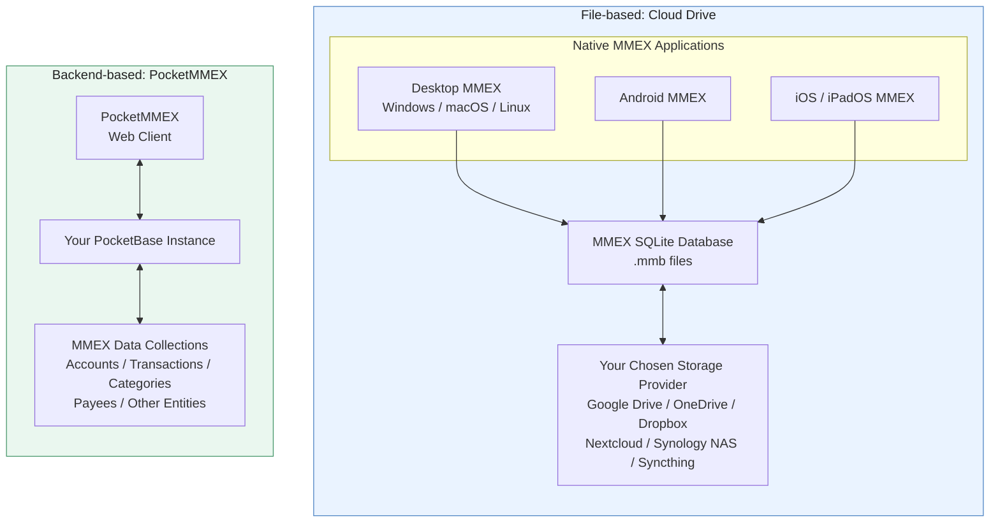

---
title: "Bring Your Own Cloud"
description: "Choose your own storage and synchronization solution with MMEX."
lead: "Your data, your storage, your choice."
date: 2024-03-04
draft: false
images: []
menu:
  docs:
    parent: "Features"
toc: true
weight: 110
---

MMEX gives you the freedom to choose where your financial data lives and how it is synchronized across devices.

Instead of locking you into a specific cloud provider, MMEX supports two approaches:

- **File-based synchronization** — Keep your MMEX database (`.mmb`) in a cloud storage location and let your preferred synchronization tool handle the rest.
- **PocketBase-based synchronization** — Use PocketMMEX with your own PocketBase instance to access and manage your financial data across devices.

Choose the approach that best fits your workflow.

## 1. Cloud Drive (File-based)

With traditional MMEX applications, your financial data is stored in a SQLite database file (`.mmb`).

You can choose any storage and synchronization provider that supports your devices.

### Supported storage solutions

**Public Cloud Providers**

- Google Drive
- Microsoft OneDrive
- Dropbox
- Other cloud storage providers

**Private Cloud Providers**

- Nextcloud
- Synology NAS
- Other self-hosted storage solutions

**Phone Storage + Synchronization Tools**

- Syncthing
- Other file synchronization tools

### Desktop MMEX

- MMEX uses POSIX file system interfaces for direct database access.
- Install your preferred cloud storage client and configure its synchronization.
- Open your MMEX database directly from the synchronized folder.
- Your cloud provider handles synchronization between devices.

### Android MMEX

- MMEX integrates with Android's Storage Access Framework (SAF).
- Install your preferred cloud storage application.
- Open or create your database in a location accessible through the Android file picker.
- Enable synchronization via `Main Menu -> Settings -> Synchronization`.
  - Set the synchronization interval to 5 minutes.
  - Enable **Sync on start**.

### iOS MMEX

- MMEX integrates with Apple's File Provider Extension (FPE).
- Install your preferred cloud storage application and enable its Files integration.
- Open or create your database in a location accessible through the Files app.
- Your cloud provider handles file synchronization.

## 2. PocketMMEX (PocketBase-based)

**PocketMMEX brings MMEX to the web, powered by PocketBase.**

Unlike traditional file-based synchronization, PocketMMEX uses a PocketBase instance as its backend. Instead of synchronizing a SQLite database file, it stores MMEX data as structured records in PocketBase collections.

### How it works

- **Your PocketBase instance**: Use your own PocketBase server to host your financial data.
- **Structured data**: Accounts, transactions, categories, payees, and other MMEX entities are stored as PocketBase records.
- **Web access**: Access your financial data through the PocketMMEX web client.
- **Multi-device access**: Multiple devices can access the same backend without synchronizing database files.
- **Data ownership**: You control your PocketBase instance, hosting environment, and data.

PocketMMEX uses PocketBase capabilities such as authentication, APIs, database storage, and real-time updates to provide a web-based MMEX experience.

### PocketMMEX vs. Cloud Drive

| Feature | Cloud Drive | PocketMMEX |
| --- | --- | --- |
| Storage model | SQLite `.mmb` file | PocketBase records |
| Backend | Cloud storage provider | Your PocketBase instance |
| Access | Native MMEX applications | PocketMMEX web client |
| Synchronization | File synchronization | Backend-based data access |
| Multi-device access | Through shared database files | Through a shared backend |
| Hosting | Public or private cloud storage | Self-hosted or hosted PocketBase |

**Important:** PocketMMEX and traditional MMEX file-based applications use different storage architectures. PocketBase does not automatically synchronize an existing `.mmb` database with native MMEX applications.

## 3. Synchronization Architecture

The following diagram illustrates the two approaches supported by the MMEX ecosystem.

Both approaches give you control over your financial data, but they use different synchronization mechanisms:

- **Cloud Drive**: Your devices access a shared database file, while the cloud storage provider synchronizes changes.
- **PocketMMEX**: Your devices access a shared PocketBase backend through the web client. Data is stored as structured records rather than a shared `.mmb` file.

## 4. Choosing Your Synchronization Solution

| Your needs | Recommended solution |
| --- | --- |
| Prefer native desktop applications | Cloud Drive |
| Already use Google Drive or Dropbox | Cloud Drive |
| Have a Synology NAS or Nextcloud | Cloud Drive |
| Want to synchronize existing `.mmb` files | Cloud Drive |
| Want browser-based access | PocketMMEX |
| Want a self-hosted backend for multiple devices | PocketMMEX |
| Prefer structured backend data over file synchronization | PocketMMEX |

## 5. Important Notes

- Desktop MMEX uses direct file access for database operations.
- Android MMEX uses SAF, so files must be accessed through compatible document providers.
- iOS MMEX uses FPE, allowing cloud-stored files to be accessed through Apple's Files integration.
- Cloud Drive synchronization depends on your provider and its synchronization behavior.
- Avoid simultaneous modifications to the same SQLite database from multiple devices. Cloud file synchronization is not a database-level multi-user synchronization mechanism.
- PocketMMEX uses a separate PocketBase-backed data architecture. It does not automatically share or synchronize the native `.mmb` database file.

With MMEX, you choose how your financial data is stored and accessed.

**Your data. Your cloud. Your choice.**
